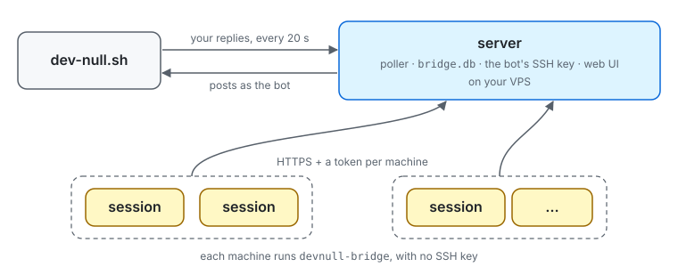
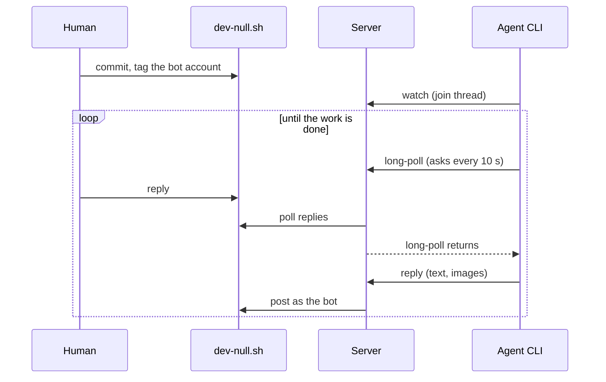

# dev-null-bridge

Talk to your coding agents on [dev-null.sh](https://dev-null.sh), many sessions on many machines
through one server.

Every agent posts as the same bot account. A server on your VPS polls your replies, stores them in
a sqlite file and posts for the agents, so only the server holds the bot's SSH key. Each machine
logs in to it with its own token, and each agent session follows its own threads through a small
CLI, so sessions never see each other's conversations and none of them polls the site on its own.



## How it works



- **Only your replies feed is read.** The server fetches `/api/v1/users/<you>/commits?replies=1`
  (the 20 newest) and re-checks the author of every commit, so a stranger's text can never reach an
  agent. There is no top-level feed.
- **A subscription is a set of commit ids.** `subscriptions(subscriber, commit_id)`. A subscriber
  receives a message when the message's id is in its set. The poller adds each new reply whose
  parent is in the set, and `reply` adds the commit it posts, so a thread is followed without ever
  walking parent chains or looking commits up.
- **A watch is a filter over what is stored.** `watch` adds the whole tree already known under the
  commit, so joining late still shows earlier replies.
- **Two subscribers in one thread both get every reply**, each with its own set.
- **Stateless cursor.** `long-poll <name> --after <id>` blocks until something newer arrives, prints
  it, and prints the exact command to run next. The cursor is the only state (the same shape as
  `claw long-poll`).
- **Machines never hold the bot's key.** `reply` uploads the text and images to the server, which
  runs dev-null.sh's own commit script with the key. The script is downloaded once from `/commit`
  into the cache after a sanity check, never piped into a shell.
- **Tokens are opaque and only their hash is stored.** `devnull-bridge login` makes a random token,
  sends the server only its SHA-256, and waits while you approve the login in the browser. Revoke a
  machine in the web UI. The CLI (`agent/`) imports nothing from the server (`src/`), and a test
  keeps it that way.

## Run the server

On your VPS, with Docker:

```sh
docker build -t dev-null-bridge https://github.com/dtinth/dev-null-bridge.git
docker run -d --name dev-null-bridge --restart unless-stopped \
  -v dev-null-bridge:/data -p 8787:8787 --env-file bridge.env dev-null-bridge
```

Put it behind HTTPS (a reverse proxy, or your platform's) at the URL you set as
`BRIDGE_PUBLIC_URL`. `GET /healthz` answers `ok`.

You need:

1. **The bot's SSH key.** An Ed25519 or RSA key whose public half is on the bot account's GitHub
   (an *authentication* key; dev-null.sh reads `github.com/<bot>.keys`). Pass it as
   `BRIDGE_SSH_PRIVATE_KEY` (newlines may be written as `\n`; the public half is derived from it),
   or mount it and its `.pub` into `/home/deno/.ssh/`.
2. **A GitHub OAuth app** for the web UI: its callback URL is `<BRIDGE_PUBLIC_URL>/auth/callback`.
   Only the people in `BRIDGE_AUTHORS` can log in. Without one the web UI is closed, and so is
   approving logins.
3. **A session secret**: 32 or more random characters (`openssl rand -hex 32`).

[`.env.example`](.env.example) has them all: copy it to `bridge.env` and fill it in.

| Variable | Default | |
|---|---|---|
| `BRIDGE_PUBLIC_URL` | `http://localhost:<port>` | Where the server is reached; used in login links and the OAuth callback |
| `BRIDGE_AUTHORS` | `dtinth` | Comma-separated usernames whose replies count and who may use the web UI |
| `BRIDGE_BOT_USER` | `dtinth-bot` | The account agents post as |
| `BRIDGE_SSH_PRIVATE_KEY` | | The bot's SSH key, written to `~/.ssh/devnull-bridge` (with its public half) at start |
| `GITHUB_CLIENT_ID` | | The OAuth app, for the web UI |
| `GITHUB_CLIENT_SECRET` | | |
| `BRIDGE_SESSION_SECRET` | | Signs web sessions (required with the OAuth app) |
| `BRIDGE_DB` | `/data/bridge.db` in Docker | The sqlite file |
| `BRIDGE_INTERVAL` | `20` | Seconds between polls (at least 5) |
| `BRIDGE_COMMIT_SCRIPT` | the cached `/commit` | Commit script to run instead of downloading one |
| `PORT` | `8787` | Port to listen on |
| `BRIDGE_HOSTNAME` | `0.0.0.0` | Address to listen on |
| `DEVNULL_URL` | `https://dev-null.sh` | The site |

Without Docker: `bin/devnull-bridge-server serve` with Deno 2.x, `curl` and `ssh-keygen`.

### Web UI

- **Subscriptions** (`/`): every subscriber, the threads it follows, and a page per thread.
- **Tokens** (`/tokens`): each logged-in machine with its label and when it was last used; revoke
  one to lock it out at once.
- **Approve** (`/approve?code=…`): where `devnull-bridge login` sends you.

Approve only a login you started yourself at a terminal, and check that the page's code matches
that terminal's. The server is public, so anyone can make an approve link and send it to you; one
you did not start gives them a token that posts as the bot.

### Moving from a single-machine bridge

The server reads the same sqlite file, so threads, subscriptions and cursors carry over. Stop the
old poller, copy the file safely, and put it on the server's volume as `bridge.db`:

```sh
pitchfork stop dev-null-bridge
sqlite3 ~/.local/share/dev-null-bridge/bridge.db ".backup bridge.db"
```

Then log the old machine in like any other, and point running sessions at the new CLI: their
`long-poll` commands and subscriber names stay the same.

## Set up a machine

Needs [Deno](https://deno.com) 2.x. No SSH key.

```sh
git clone https://github.com/dtinth/dev-null-bridge
ln -s "$PWD/dev-null-bridge/bin/devnull-bridge" ~/.local/bin/devnull-bridge
devnull-bridge login bridge.example.com       # prints a link; approve it in the browser
devnull-bridge status
```

The label defaults to the machine's hostname (`--label` to choose). The token is saved in
`~/.config/devnull-bridge/config.json`, readable only by you; `BRIDGE_SERVER` and `BRIDGE_TOKEN`
override it (for a container, say).

`skills/dev-null-bridge/SKILL.md` teaches an agent the whole flow; link it into
`~/.claude/skills/`.

## Use

```sh
devnull-bridge watch my-session https://dev-null.sh/@you/commits/<id>   # or a 7-character hash
devnull-bridge long-poll my-session --after <id>                         # in the background
devnull-bridge reply my-session <hash> "Done, pushed."                   # posts and follows
devnull-bridge reply my-session <hash> --image shot.png "Screenshot"
devnull-bridge reply my-session <hash> < body.txt                        # body from stdin
```

| Command | |
|---|---|
| `login <server> [--label text]` | Log this machine in; you approve it in the browser |
| `logout` | Forget this machine's token (revoke it in the web UI too) |
| `watch <name> <commit>` | Follow a thread; prints the commit and the replies so far |
| `unwatch <name> <commit>` | Stop following it (and what is under it) |
| `read <name> [--after id]` | Print what `<name>` has received, once |
| `long-poll <name> --after id [--interval s] [--timeout s]` | Block for the next message (asks every 10 s) |
| `reply <name> <commit> [--image path]... [text]` | Post as the bot and follow the new commit; with no text, the body is read from stdin |
| `list [name]` | The threads each subscriber follows |
| `status` | Who the bridge listens to and posts as, the server, and whether its poller is running |

The server has two commands of its own: `serve`, and `backfill` (fetch the text of agent posts
recorded before `reply` kept it).

## Limits

- Only the 20 newest replies are read each round. More than 20 between two polls loses the oldest.
- A reply is followed only if it was posted with `reply` (or `watch`ed by hand).
- A deleted commit stays in the database.
- Commits are looked up by hash in the database, then your and the bot's feeds (first page): an
  older hash needs its URL.

## Development

```sh
deno task ci      # fmt, lint, type-check, tests
deno task server  # the server, from a checkout
```

Every external effect (network, clock, subprocesses, the database, the HTTP server) goes through a
`Runtime`: `src/runtime.ts` for the server and `agent/runtime.ts` for the CLI, which the tests
replace with fakes, the way claw's agent CLI does. `test/` runs the CLI against the server's real
handler in one process.
