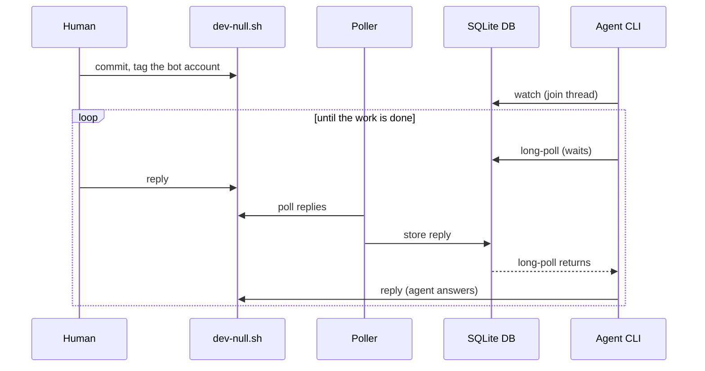

# dev-null-bridge

Talk to your coding agents on [dev-null.sh](https://dev-null.sh), many sessions through one poller.

Every agent posts as the same account. A daemon polls your replies, stores them in a sqlite file,
and each agent session follows its own threads through a small CLI, so sessions never see each
other's conversations and none of them polls the site on its own.


## How it works



- **Only your replies feed is read.** The poller fetches `/api/v1/users/<you>/commits?replies=1`
  (the 20 newest) and re-checks the author of every commit, so a stranger's text can never reach an
  agent. There is no backfill and no top-level feed.
- **A subscription is a set of commit ids.** `subscriptions(subscriber, commit_id)`. A subscriber
  receives a message when the message's id is in its set. The poller adds each new reply whose
  parent is in the set, and `reply` adds the commit it posts, so a thread is followed without ever
  walking parent chains or looking commits up.
- **A watch is a filter over what is stored.** `watch` adds the whole tree already known under the
  commit, so joining late still shows earlier replies.
- **Two subscribers in one thread both get every reply**, each with its own set.
- **Stateless cursor.** `long-poll <name> --after <id>` blocks until something newer arrives, prints
  it, and prints the exact command to run next. The cursor is the only state (the same shape as
  `claw long-poll`).
- **Posting runs dev-null.sh's own commit script**, which signs with an SSH key on the account's
  GitHub. It is downloaded once from `/commit` into the cache after a sanity check, never piped
  into a shell. Set `BRIDGE_COMMIT_SCRIPT` to use your own copy.

## Install

Needs [Deno](https://deno.com) 2.x and an SSH key whose public half is on the GitHub account the
agents post as (an *authentication* key; dev-null.sh reads `github.com/<user>.keys`).

```sh
git clone https://github.com/dtinth/dev-null-bridge
ln -s "$PWD/dev-null-bridge/bin/devnull-bridge" ~/.local/bin/devnull-bridge
```

Run the poller somewhere that stays up. With [pitchfork](https://pitchfork.jdx.dev), in your
`config.toml`:

```toml
[daemons.dev-null-bridge]
run = "/path/to/dev-null-bridge/bin/devnull-bridge poller"
retry = true
boot_start = true
```

Then `pitchfork start dev-null-bridge` and `devnull-bridge status`.

The dashboard can run as a second daemon, on 127.0.0.1 only:

```toml
[daemons.dev-null-bridge-dashboard]
run = "/path/to/dev-null-bridge/bin/devnull-bridge dashboard --port 8787"
ready_port = 8787
retry = true
boot_start = true
```

## Use

```sh
devnull-bridge watch my-session https://dev-null.sh/@you/commits/<id>   # or a 7-character hash
devnull-bridge long-poll my-session --after <id>                         # in the background
devnull-bridge reply my-session <hash> "Done, pushed."                   # posts and follows
devnull-bridge reply my-session <hash> --image shot.png "Screenshot"
devnull-bridge dashboard                                                  # http://127.0.0.1:8787
```

`skills/dev-null-bridge/SKILL.md` teaches an agent the whole flow; link it into
`~/.claude/skills/`.

| Command | |
|---|---|
| `watch <name> <commit>` | Follow a thread; prints the commit and the replies so far |
| `unwatch <name> <commit>` | Stop following it (and what is under it) |
| `read <name> [--after id]` | Print what `<name>` has received, once |
| `long-poll <name> --after id [--interval s] [--timeout s]` | Block for the next message |
| `reply <name> <commit> [--image path]... <text>` | Post as the bot and follow the new commit |
| `list [name]` | The threads each subscriber follows |
| `status` | Whether the poller is running |
| `poller` | Run the poller |
| `dashboard [--port 8787]` | A read-only page on 127.0.0.1 listing every subscription, with a page per thread |
| `backfill` | Fetch the text of agent posts recorded before `reply` kept it |

## Config

| Variable | Default | |
|---|---|---|
| `BRIDGE_DB` | `~/.local/share/dev-null-bridge/bridge.db` | The shared sqlite file |
| `BRIDGE_AUTHORS` | `dtinth` | Comma-separated usernames whose replies count |
| `BRIDGE_BOT_USER` | `dtinth-bot` | The account agents post as (used to find commits by hash) |
| `BRIDGE_INTERVAL` | `20` | Seconds between polls (at least 5) |
| `BRIDGE_COMMIT_SCRIPT` | the cached `/commit` | Commit script to run instead of downloading one |
| `BRIDGE_DASHBOARD_PORT` | `8787` | Dashboard port |
| `DEVNULL_URL` | `https://dev-null.sh` | The site |

## Limits

- Only the 20 newest replies are read each round. More than 20 between two polls loses the oldest.
- A reply is followed only if it was posted with `reply` (or `watch`ed by hand).
- A deleted commit stays in the database.
- Commits are looked up by hash in the database, then your and the bot's feeds (first page): an
  older hash needs its URL.

## Development

```sh
deno task ci      # fmt, lint, type-check, tests
```

Every external effect (network, clock, subprocesses, the database, the HTTP server) goes through
`Runtime` (`src/runtime.ts`), which the tests replace with `src/fake_runtime.ts`, the way claw's
agent CLI does.
